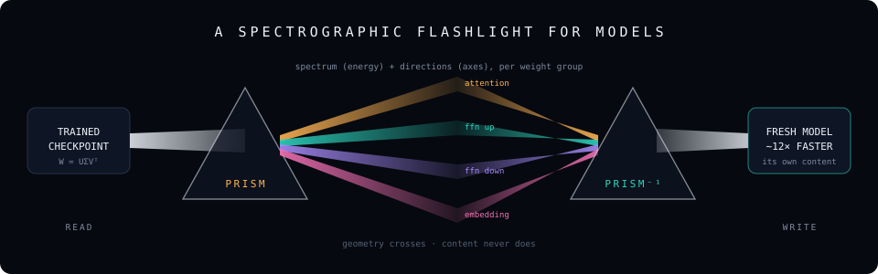
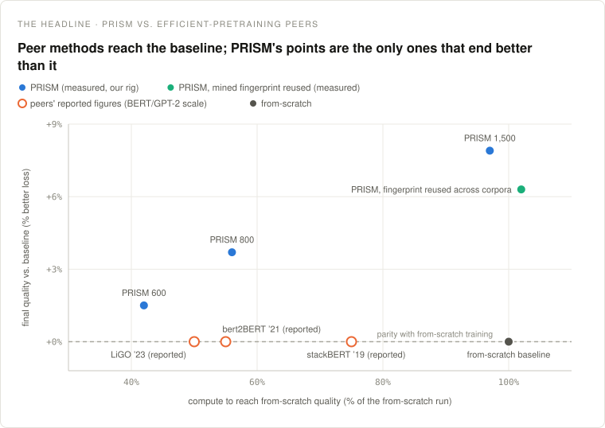
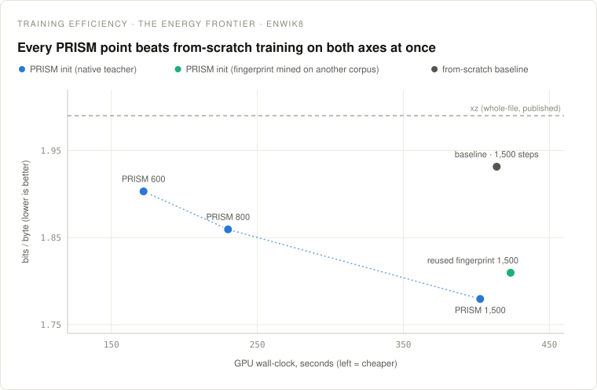
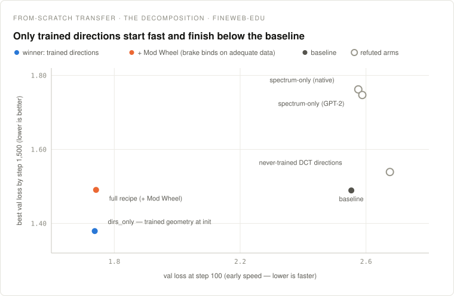
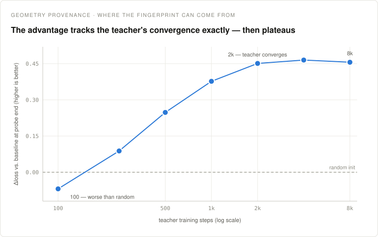
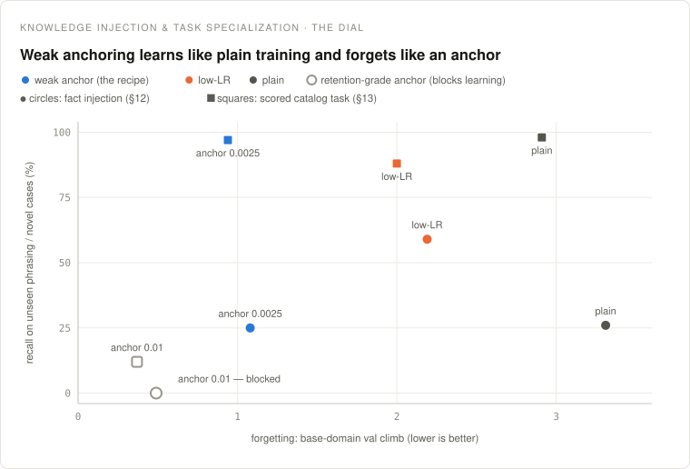
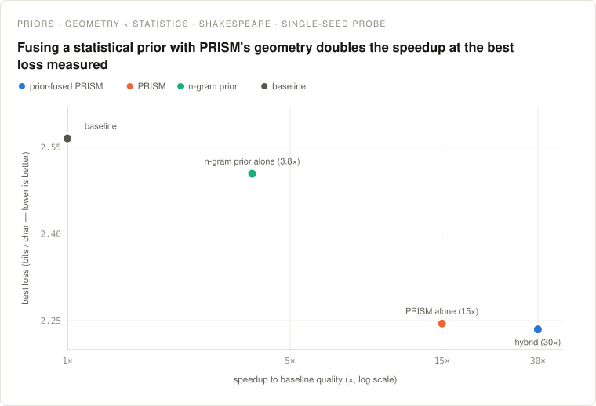
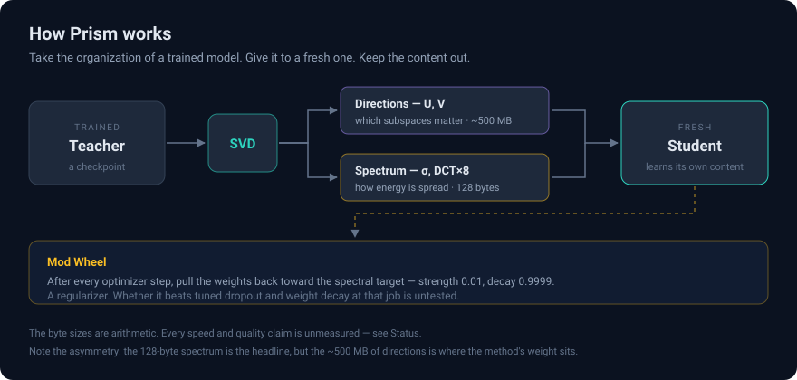
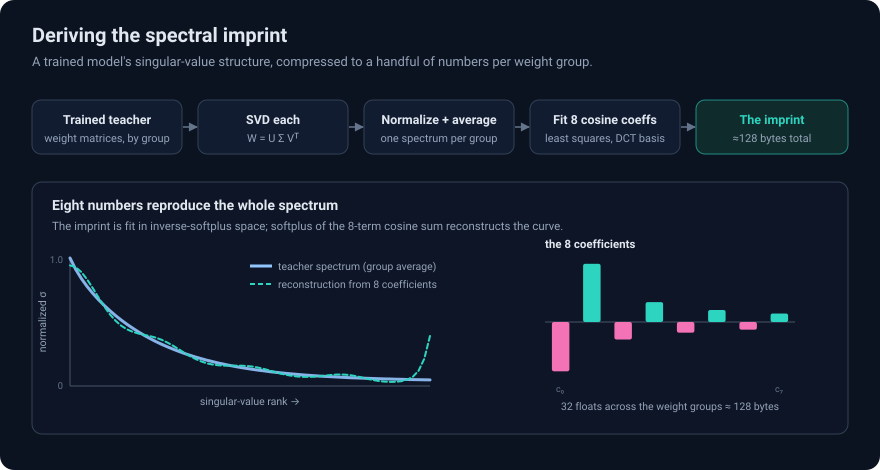
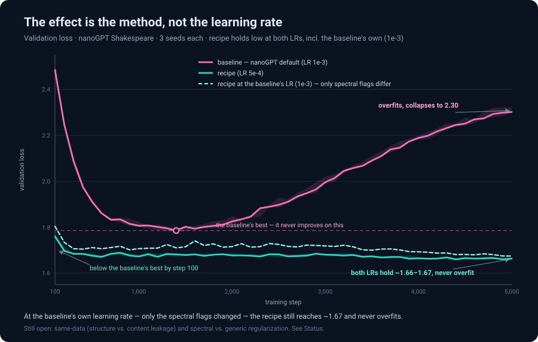

# PRISM

**Take the geometry of a trained neural network — which subspaces it uses, how
its energy is distributed — and hand it to a fresh model at initialization,
then leave it alone. On the canonical byte-modeling benchmark, that model
reaches from-scratch training's final quality at 42% of the GPU time, and at
equal time converges far below anything from-scratch training ever reaches.
No weights copied, no data shared. Only geometry.**

PRISM extracts that geometry, transplants it, and measures — one committed
artifact per claim — which parts of it carry the effect. This repo has killed
several of its own hypotheses on the way; everything below is what survived.

*(Formerly `nanogpt-prism-shakespeare`; the predecessor repository is
archived privately and its full history is preserved by Timepoint.)*



<a href="https://timepointai.github.io/PRISM/docs/how-prism-works.html"></a>

---

The bench is deliberately small — nanoGPT-class models (10.65M params), three
seeds for every claim, one L4 — and the corpora run from Shakespeare through a
committed slice of 2024 web text to enwik8. Every number below has an artifact
in [`results/`](results/). The bench is just the pointing hand: **the claims
are about the finger, not what it happens to be pointing at.**

## What the evidence says

The charts in this section are the **Results Atlas**. Every point is the
median of three seeds from a committed artifact in [`results/`](results/)
(single-seed probes are flagged), and every chart lists its artifact IDs, its
data, and where it sits against the published literature (expand the
notes under each one).



**The headline, against the field.** Growth-based efficient-pretraining
methods report reaching the from-scratch baseline sooner, and every one of
them stops there, at parity (y = 0). PRISM's points are the only ones that
end *better* than the baseline. Each growth method needs a smaller pretrained
checkpoint from the same family; PRISM's teacher cost sits outside its
percentages exactly as the peers' checkpoint cost sits outside theirs — and
it amortizes across corpora (aqua: a fingerprint mined on a different corpus
entirely).

<sub>Solid marks: measured in this rig (enwik8, 3 seeds, wall-clock). Hollow
marks: the methods' own reported figures at BERT/GPT-2 scale — claims mapped
onto one frame, **not a head-to-head**. PRISM points:
`dirs_only_20260728T{054705,085214,102700,065345}Z.json`.</sub>

<details>
<summary>Data, sources, and how the peer points were placed</summary>

| point | compute to reach from-scratch quality | final quality vs. baseline | source |
|---|---|---|---|
| from-scratch baseline (1,500 steps) | 100% | +0% | `dirs_only_20260728T054705Z.json` |
| PRISM, 600 steps | 42% | +1.5% | `dirs_only_20260728T085214Z.json` |
| PRISM, 800 steps | 56% | +3.7% | `dirs_only_20260728T102700Z.json` |
| PRISM, 1,500 steps | 97% | +7.9% | `dirs_only_20260728T054705Z.json` |
| PRISM, fingerprint reused across corpora | 102% | +6.3% | `dirs_only_20260728T065345Z.json` |
| progressive stacking ('19) | 75% | +0% (parity) | reported — [Gong et al. 2019](https://proceedings.mlr.press/v97/gong19a.html), ~25% training saved |
| bert2BERT ('21) | 55% | +0% (parity) | reported — [Chen et al. 2021](https://arxiv.org/abs/2110.07143), ~45% saved for BERT-Base |
| LiGO ('23) | 50% | +0% (parity) | reported — [Wang et al. 2023](https://arxiv.org/abs/2303.00980), up to ~50% saved |

PRISM's x is the GPU wall-clock of the complete run as a share of the
1,500-step baseline's; y is the bits/byte gain over the baseline's best.

All three peers grow a bigger model from a smaller *same-family,
same-corpus* pretrained checkpoint by copying or mapping its weights:
content moves, so the corpus moves with it. PRISM moves only geometry — no
family requirement beyond matching dimensions, demonstrated corpus-crossing
(the aqua point), and a measured better-than-baseline endpoint no growth
method claims. Two asymmetries: the peer figures come from far larger models
than this 10.65M probe, and none of the three has been run in this rig (nor
PRISM in theirs). The head-to-head is future work, not implied.

</details>

### 1. Geometry-at-init beats training from scratch — outright, on real benchmarks

Inject a trained model's directions and spectrum into a fresh model at
initialization, then train it with *no further intervention* (`dirs_only`).
On two corpora where the baseline is at full strength:

- **2024 web text** (byte-level FineWeb-Edu, corpus committed with provenance):
  reaches the baseline's best quality **3.3×** faster (2.9–3.9, resolved, 3/3
  seeds) and **converges 0.11 nats below anything the baseline ever reaches** —
  against a baseline that never overfits ([`RESULTS.md`](RESULTS.md) §11).
- **enwik8** (the Hutter-Prize corpus, standard 90M/5M split): **2.90×**
  (2.72–3.10) to baseline-best, converging **0.152 bits/byte below it**
  (1.780 vs 1.932 bpb). The 90M pool means the student never repeats a byte —
  zero epochs, the least hospitable setting for any memorization explanation.
  It passes the baseline's *final* quality around step 500 and leads by 1.40
  bpb at step 100 ([`RESULTS.md`](RESULTS.md) §14).

### 2. That converts into an energy frontier where every point dominates

Because the transplant does its work at initialization, you can simply train
for less time. Complete short schedules (full warmup and LR decay, not
truncated runs), wall-clock recorded inside each artifact, enwik8:

| arm | bits/byte | vs. baseline's best | GPU time |
|---|---|---|---|
| baseline, 1,500 steps | 1.9315 | — | 414s (100%) |
| **PRISM-init, 600 steps** | 1.9031 | **−0.028** | **172s (42%)** |
| **PRISM-init, 800 steps** | 1.8595 | **−0.072** | **230s (56%)** |
| PRISM-init, 1,500 steps | 1.7796 | −0.152 | 403s (97%) |
| PRISM-init, 1,500 steps, fingerprint mined on web text | 1.8096 | −0.122 | 423s (102%) |

Every row beats the baseline's best on every seed; the 600-step *baseline*
control (1.75 nats) shows the short schedule alone does nothing. The teacher
that supplies the geometry is a **one-time mined cost that amortizes**: a
fingerprint mined on the web-text corpus accelerates enwik8 students at
**1.97×**, still converging 0.122 bpb below their baseline — one mining run
serves many corpora ([`RESULTS.md`](RESULTS.md) §16).



<sub>Bits-per-byte (val, standard 90M/5M split) vs. measured GPU wall-clock;
complete schedules, matched LRs, 3 seeds; data in the table above. The dashed
line is xz/LZMA's published whole-file figure (≈1.99 bpb), shown for
orientation only — a different protocol; gzip (2.92) and bzip2 (2.32) sit far
above the chart. The reused-fingerprint point's teacher was trained only on
the 4.5M-token web corpus — mined once, reused here.
`dirs_only_20260728T{054705,085214,102700,065345}Z.json`</sub>

<details>
<summary>How this compares to the literature</summary>

The published mechanisms that reuse a smaller trained model to cheapen a
bigger run — [LiGO](https://arxiv.org/abs/2303.00980) (learned growth maps,
up to ~50% compute saved) and Net2Net-style function-preserving growth — copy
*content* and need a same-family checkpoint. Distillation needs the teacher
forwarded at student-training time. In PRISM only geometry moves, the teacher
is one extraction amortized across corpora (the reused-fingerprint row), and
the known generalization penalty of naive weight reuse
([Ash & Adams 2020](https://arxiv.org/abs/1910.08475)) does not apply because
no content is inherited. The 42–58% savings at probe scale sit in LiGO's band
with weaker requirements — not yet compared head-to-head. The
optimizer/speedrun lever (Muon et al.) is an orthogonal, possibly composable
axis.

</details>

### 3. It's the finger, not what it points at

Four escalating experiments built to kill the "the teacher leaked its
content" explanation. All four failed to kill the effect — the transfer is
**structural, not content**:

- **Same corpus, disjoint data:** teacher and student share 100% or 0% of
  their training text — the head start is identical (Δloss 0.57–0.59 either
  way; [`RESULTS.md`](RESULTS.md) §3).
- **Different corpus:** move the student to Sherlock Holmes and score it on
  held-out Sherlock — the advantage *grows* slightly (0.591 → 0.627; §4).
- **A teacher that never saw the corpus:** its fingerprint still delivers
  **4.6×** (vs. 9.9× same-corpus, identical rig) at ~80% of the quality gain
  (§10).
- **Reuse across benchmarks:** the web-text fingerprint on enwik8, above —
  1.97×, still better-than-baseline convergence (§16).

### 4. The directions carry it — and they must be mined, not drawn

The ablation triad answers *which part* of the geometry does the work, and
*where it can come from*:

- **Trained directions win** (finding 1). Remove them and keep everything
  else, and the model sits **below baseline at every step** (§11).
- **Random directions lose** (§11). **Never-trained *structured* directions
  also lose**: analytic DCT bases — smooth, orthonormal, mathematically
  ideal — give a slightly better step-0 loss and then fall behind for the
  rest of training, 3/3 seeds (§15). Well-formedness is not the load-bearing
  property; **training is**. Geometry is *mined* from trained models, not
  *drawn* from mathematics — which makes trained checkpoints a reusable
  commons, and mining + reuse (finding 2) the economically interesting
  operation.
- The effect tracks the mine's quality exactly: it grows with teacher
  training and **saturates right where the teacher converges** (~2,000 steps
  here; longer teachers add nothing), and a barely-trained teacher's geometry
  is *worse than random init* (§5).



<sub>Modern-web bench (FineWeb-Edu, byte-level); val loss at step 100 vs. best
val loss over 1,500 steps; medians of 3, matched schedules (§11, §15).
Lower-left is better on both axes, and only geometry-at-init with trained
directions lives there. The spectrum-only arms (the native teacher's or
GPT-2's 40 numbers — note they tie) and the never-trained analytic-DCT
directions all finish above the baseline: the directions carry the effect,
and they must be mined from a trained model. `recipe_20260727T145008Z` ·
`dirs_only_20260727T154359Z` · `spectral_only_20260727T1450{28,39}Z` ·
`dirs_only_20260728T060256Z`</sub>

<details>
<summary>Data, and how this compares to the literature</summary>

| arm | val loss @ step 100 | best val loss by step 1,500 | artifact |
|---|---|---|---|
| baseline | 2.553 | 1.4892 | (shared across the files) |
| **dirs_only — trained geometry at init** | **1.738** | **1.3794** | `dirs_only_20260727T154359Z` |
| full recipe (+ Mod Wheel) | 1.742 | 1.4907 | `recipe_20260727T145008Z` |
| spectrum-only (native teacher) | 2.576 | 1.7623 | `spectral_only_20260727T145028Z` |
| spectrum-only (GPT-2's public weights) | 2.588 | 1.7471 | `spectral_only_20260727T145039Z` |
| never-trained DCT directions | 2.676 | 1.5390 | `dirs_only_20260728T060256Z` |

The baseline arm *is* the classic-init world (Xavier/He/orthogonal);
[μTransfer](https://arxiv.org/abs/2203.03466) moves hyperparameters across
scale, not weights — orthogonal to all of this. The strongest outside
evidence that structure can be *drawn* rather than mined is
[mimetic initialization](https://arxiv.org/abs/2305.09828) (Trockman &
Kolter 2023): a closed-form init that makes attention "look pretrained," with
real gains on vision transformers. That doesn't contradict the §15
refutation — §15 tested smooth per-matrix bases, mimetic init constructs
*inter-matrix products* — but it names the open cell: a mimetic-style
analytic fingerprint is the one drawn-geometry family this rig hasn't priced.

</details>



<sub>Same-data probe, 300-step students: early advantage Δloss vs. teacher
training steps (Runs F + I, §5). A barely-trained teacher's geometry is worse
than random init; the advantage rises monotonically and saturates at ≈2,000
steps — right where the teacher itself converges. Mining geometry costs one
converged training run; more adds nothing. `recipe_20260721T143246Z` ·
`recipe_20260721T172238Z`</sub>

<details>
<summary>Data, and how this compares to the literature</summary>

| teacher steps | 100 | 250 | 500 | 1,000 | 2,000 | 4,000 | 8,000 |
|---|---|---|---|---|---|---|---|
| Δloss vs. baseline | −0.069 | 0.088 | 0.248 | 0.377 | 0.451 | 0.465 | 0.456 |

Distillation's capacity-gap literature finds that a stronger teacher is
*not* always a better teacher; PRISM's lever is cleaner — monotone until the
teacher's geometry converges, then flat — because only geometry transfers.
The shape agrees with the critical-early-period line of work (Achille et
al.'s critical learning periods; Frankle et al.'s early-phase analyses): the
structure a network commits to in its first steps is disproportionately
load-bearing, which is exactly the window PRISM's init pre-pays (the ~6×
early-window advantage in §11: the quality `dirs_only` has at step 100, the
baseline needs 600–650 steps to reach).

</details>

### 5. The spectrum is the universal part — honestly priced

The spectrum half of the geometry compresses to **40 numbers** (5 weight
groups × 8 DCT coefficients, ~160 bytes) and crosses model size, tokenizer,
and corpus *simultaneously*: a fingerprint read off **OpenAI's public GPT-2
weights** ([`fingerprints/gpt2-124M/`](fingerprints/gpt2-124M/)) performs at
parity with a purpose-trained teacher's spectrum (1.747 vs 1.762, GPT-2's
marginally better). The honest other half: in spectrum-*only* mode both sit
below baseline — universality is proven, sufficiency is refuted (§11). The
universal init worth building is directional (see What's next).

### 6. Pointed backward, the same machinery retains: ~10× less forgetting

Anchor a trained model to its **own** pre-finetune weights with one line per
optimizer step — `W ← (1−s)·W + s·W₀` — and finetuning on a new domain
forgets **up to ~10× less** while still genuinely learning (the anchored
model beats a from-scratch ceiling on the new domain). It Pareto-dominates
the low-learning-rate alternative (~2× the retention at equal adaptation),
and the attribution matches finding 4: anchoring only the spectrum does
nothing (1.07×), a wrong-spectrum placebo actively harms (0.39×) — it is the
directions being pinned that retains
([`docs/FINETUNE-RETENTION.md`](docs/FINETUNE-RETENTION.md)). And the two
uses compound: a PRISM-*pretrained* base finetunes with **≈ zero forgetting
and ~8% better adaptation** at matched quality
([`docs/UNIFIED-ARC.md`](docs/UNIFIED-ARC.md)).


<sub>Shakespeare base finetuned 1,000 steps on Sherlock; forgetting =
old-domain val climb vs. new-domain best; medians of 3 (Run J). Down and left
is better. At comparable adaptation the anchor retains ~2× more than low-LR;
anchoring only the spectrum does nothing (≈ plain), and a wrong-spectrum
placebo is worse than no anchor at all — the directions are what retain.
`finetune_20260721T215319Z.json`</sub>

<details>
<summary>Data, and how this compares to the literature</summary>

| arm | new-domain best (adaptation) | forgetting (old-domain climb) |
|---|---|---|
| plain finetune | 1.252 | +0.428 |
| **anchor, pull 0.02** | 1.368 | **+0.043** |
| **anchor, pull 0.01** | 1.337 | **+0.067** |
| **anchor, pull 0.005** | 1.307 | **+0.090** |
| no anchor, LR 5e-5 | 1.297 | +0.227 |
| no anchor, LR 1e-4 | 1.277 | +0.282 |
| anchor the spectrum only | 1.254 | +0.399 |
| anchor a shuffled (wrong) spectrum | 1.413 | +1.085 |

The raw anchor belongs to a known family —
[L2-SP](https://arxiv.org/abs/1802.01483) (penalize distance to init) and
[EWC](https://arxiv.org/abs/1612.00796) (Fisher-weighted) — and the
contribution here is the attribution: directional, not spectral; a placebo
that actively harms; and Pareto-dominance over matched low-LR.
Function-space cousins (KL-to-reference in RLHF, LwF) pay a reference-model
forward pass per step; [Elastic Reset](https://arxiv.org/abs/2312.07551)
lerps to the base periodically where this anchor pulls continuously; WiSE-FT
and task-vector arithmetic merge weights *after* training where the anchor
steers *during* it.

</details>

### 7. How hard you pin decides what you can learn — a dial with measured bands

The per-step pull is a **continuous dial between plasticity and retention**,
and three studies price its bands:

- **From scratch on scarce data, full strength is the win:** on 1M-token
  Shakespeare every baseline overfits (1.78 → ~2.31); the pull toward the
  spectral target holds ~1.66–1.67 with no overfitting, reaching baseline
  quality **11.8×** faster as tuned, **7×** schedule-matched
  ([`RESULTS.md`](RESULTS.md) §1–2). On adequate data the same pull costs the
  entire endpoint lead — drop it and init-only wins (§11).
- **Injecting new facts, retention-grade strength blocks learning outright:**
  2–3% closed-book recall vs 98–100% unanchored — while posting the *best*
  validation loss of any arm. **Loss is not an injection metric**; only
  exact-match caught it. The weak band (s≈0.0025) injects at parity with
  plain training while forgetting **3× less** (§12).
- **On a scored task** (a catalog-review workflow with rule-generated ground
  truth, evaluated on never-seen cases), the weak band **Pareto-dominates
  low-LR on both axes**: 97% vs 88% on novel cases at half the forgetting
  (§13). Side finding: facts store in *either* attention or FFNs when the
  other is pinned — storage is not FFN-exclusive at this scale (§12).



<sub>Modern-web base; closed-book exact-match on held-out phrasing / novel
cases vs. general-ability forgetting. Circles: fact injection (§12). Squares:
scored catalog task (§13). Medians of 3. Up and left is better. At
retention-grade strength (0.01) the anchor blocks learning outright in both
studies — while posting the best validation loss, which is why loss alone
can't score injection. The weak band (0.0025) keeps task accuracy at parity
and, on the scored task, beats low-LR on both axes at once.
`finetune_20260727T203023Z` · `finetune_20260727T230910Z` ·
`finetune_20260728T044511Z`</sub>

<details>
<summary>Data, and how this compares to the literature</summary>

| arm | study | forgetting (base-domain climb) | recall on unseen phrasing / novel cases |
|---|---|---|---|
| plain | facts | 3.31 | 26% |
| low-LR 1e-4 | facts | 2.19 | 59% |
| **weak anchor, 0.0025** | facts | **1.08** | 25% |
| anchor 0.01 — blocked | facts | 0.49 | 0% |
| plain | catalog task | 2.91 | 98% |
| low-LR 1e-4 | catalog task | 2.00 | 88% |
| **weak anchor, 0.0025** | catalog task | **0.94** | **97%** |
| anchor 0.01 — blocked | catalog task | 0.37 | 12% |

[Biderman et al. 2024](https://arxiv.org/abs/2405.09673) found the same axis
with a different constraint: LoRA "learns less and forgets less" than full
finetuning (its updates are 10–100× lower-rank). The weak band claims a
better point on that axis at probe scale — learning at parity with 3× less
forgetting — unverified at 7B. The editing school (ROME/MEMIT) writes facts
without training, guided by FFN-as-key-value localization (Geva et al.
2021); but [Hase et al. 2023](https://arxiv.org/abs/2301.04213) showed edit
success is uncorrelated with where causal tracing says facts live — and the
free-attention cell here (92% recall with FFNs pinned) lands on Hase's side
at 10M scale: storage goes wherever capacity is free. The industry's third
answer is keeping facts out of weights entirely (retrieval).

</details>

### 8. Geometry compounds with statistics

Fuse a fixed shared n-gram prior into the logits (product of experts, so the
model learns only the residual) and stack PRISM on top: PRISM alone 15×, the
n-gram alone 3.8×, **the hybrid 30× — at the best loss of all four arms**,
below even the n-gram's own floor. Single-seed probe; the documented path to
reaching baseline quality *at initialization* runs through a context-4+
sparse prior ([`docs/PRIOR-FUSED-PRISM.md`](docs/PRIOR-FUSED-PRISM.md)).



<sub>Shakespeare bench: steps-to-baseline-quality speedup (log) vs. best loss
in bits/char. **Single-seed probe** — a flagged exception to the 3-seed rule.
The n-gram prior alone tops out above its own floor; PRISM's geometry is what
carries the hybrid below every other arm. The defensible claim is
compounding — the hybrid beats PRISM alone at the best loss — not that PRISM
alone is 30×. `prior_20260725T011443Z.json`</sub>

<details>
<summary>Data, and how this compares to the literature</summary>

| arm | speedup to baseline quality | best loss (bits/char) |
|---|---|---|
| baseline | 1.0× | 2.565 |
| n-gram prior alone | 3.8× | 2.504 |
| PRISM alone | 15× | 2.245 |
| **prior-fused PRISM (hybrid)** | **30×** | **2.235** |

Inference-time statistical interpolation is established:
[kNN-LM](https://arxiv.org/abs/1911.00172) improves strong LMs by mixing in
datastore lookups, ∞-gram scales suffix-array n-grams to trillions of
tokens, and ["language modeling is compression"](https://arxiv.org/abs/2309.10668)
frames the equivalence. Prior-Fused PRISM differs in *when* the prior enters
— fixed at *training* time (product of experts), so the network learns only
the residual — and in the compounding claim: the geometric init pushes the
hybrid below the prior's own floor, which pure interpolation cannot do.

</details>

### The ledger

| study | finding | evidence |
|---|---|---|
| **Modern-web transfer** | geometry-at-init beats a non-overfitting baseline: **3.3×**, **−0.11 nats** beyond its best | [`RESULTS.md`](RESULTS.md) §11 |
| **enwik8** | same effect on the canonical bench: **2.90×**, **−0.152 bpb**, zero-epoch regime | [`RESULTS.md`](RESULTS.md) §14 |
| **The energy frontier** | baseline's full quality at **42%** of the GPU time; −0.072 bpb at **56%**; teacher fingerprint amortizes across corpora at **1.97×** | [`RESULTS.md`](RESULTS.md) §16 |
| **Structure, not content** | head start identical at 100% and 0% data overlap; grows on a different corpus | [`RESULTS.md`](RESULTS.md) §3–4 |
| **Teacher-free init** | a teacher that never saw the corpus keeps **4.6×** of 9.9× and ~80% of the quality gain | [`RESULTS.md`](RESULTS.md) §10 |
| **Attribution: directions** | spectrum-only below baseline; trained directions required — random *and* never-trained analytic bases both refuted | [`RESULTS.md`](RESULTS.md) §11, §15 |
| **Spectrum universality** | GPT-2's 40 public-weight numbers ≈ a native teacher's spectrum across size, tokenizer, corpus | [`RESULTS.md`](RESULTS.md) §11 |
| **From-scratch, scarce data** | **11.8×** tuned / **7×** matched with no overfitting, where every baseline overfits | [`RESULTS.md`](RESULTS.md) §1–2 |
| **Finetune retention** | directional self-anchor → up to **~10× less forgetting**, Pareto-dominating low-LR | [`docs/FINETUNE-RETENTION.md`](docs/FINETUNE-RETENTION.md) |
| **The arc** | PRISM-pretrained base: **≈0 forgetting, ~8% better adaptation** at matched quality | [`docs/UNIFIED-ARC.md`](docs/UNIFIED-ARC.md) |
| **Fact injection** | the anchor is an injection↔retention dial: 0.01 blocks storage (2–3% recall), the weak band injects at parity with **3× less** forgetting; LM loss can't see any of it | [`RESULTS.md`](RESULTS.md) §12 |
| **Task specialization** | on a scored workflow, the weak band Pareto-dominates low-LR: 97% on novel cases at half the forgetting | [`RESULTS.md`](RESULTS.md) §13 |
| **Prior-Fused PRISM** | geometry × statistics: **30×** hybrid at the best loss of all arms (single-seed probe) | [`docs/PRIOR-FUSED-PRISM.md`](docs/PRIOR-FUSED-PRISM.md) |

Every number has a matching committed `results/*.json` (loss curves,
provenance, git commit, argv, wall-clock, censoring flags). A claim without an
artifact is not a result in this repo.


## How it works

Every weight matrix of a trained model factors as `W = U Σ Vᵀ`: the
**directions** (U, V — which subspaces the model decided were worth using) and
the **spectrum** (Σ — how much energy it put in each). Together they describe
the model's *organization* without describing anything it *knows*. PRISM is
three operations on that geometry, with roles the ablations have priced:

1. **EigenTransfer** — blend the fresh model's singular vectors 75% toward the
   teacher's, then re-orthogonalize. *The active ingredient — and the teacher
   must be a trained model: analytic and random substitutes both fail.*
2. **Spectral Imprint** — compress the teacher's singular-value distribution
   to 8 DCT coefficients per weight group (**40 numbers, ~160 bytes**) and
   reshape the fresh model's spectrum to match at init. *Universal across
   models and corpora; supporting role.*
3. **Mod Wheel** — after every optimizer step, pull the weights gently back
   toward a stored target: `W ← (1−s)·W + s·W_target`. *An overfitting brake
   (forward, scarce data) and the retention anchor (backward), with a
   measured strength dial.*

No parameters are copied. The student learns its own content from scratch — it
just doesn't spend its first several hundred steps rediscovering *which
subspaces a trained transformer uses*.





The same parts run in two directions:

- **Forward (transfer):** inject the geometry at init. Directions do the
  lifting; the spectrum is the cheap universal part; add the wheel only when
  the corpus is small enough to overfit. The fingerprint can be mined once
  and reused across corpora at ~⅔ strength.
- **Backward (retain):** the wheel again, anchored to the model's **own**
  pre-finetune weights — pinning the directions is what prevents forgetting,
  and the strength `s` is the plasticity dial (weak band ≈0.0025 for
  injecting new material, ~0.01–0.02 for maximum retention):

```
W  ←  (1 − s)·W  +  s·W₀        # after each step; W₀ = pre-finetune weights
```



## Where PRISM sits: the mechanism map

Every one of PRISM's individual operations has published relatives. This is
literature positioning, not a head-to-head: no external mechanism has been
run in this rig (except the low-LR frontier), and published numbers come
from different scales and tasks. What each family moves, what it needs, and
where PRISM sits:

| mechanism family | what moves / constrains | what it needs | relation to PRISM |
|---|---|---|---|
| Classic init (Xavier / He / orthogonal) | variance & isometry at init | nothing | the baseline arm — the gray point in every chart above |
| [Mimetic init](https://arxiv.org/abs/2305.09828) (Trockman & Kolter '23) | analytic "pretrained-looking" attention products | nothing | drawn structure that works on ViTs; the untested open cell against the §15 refutation of smooth bases |
| [μP / μTransfer](https://arxiv.org/abs/2203.03466) | hyperparameters across width | a small-model tuning run | orthogonal axis; likely composable, untested |
| [LiGO](https://arxiv.org/abs/2303.00980) / Net2Net / stacking | weights, via growth maps | a same-family smaller checkpoint | copies content (up to ~50% savings); PRISM moves geometry only, crosses corpora, saves 42–58% at probe scale |
| Distillation (Hinton '15) | the teacher's function, per step | teacher forward passes during training | continuous teacher cost vs. one amortized extraction |
| [L2-SP](https://arxiv.org/abs/1802.01483) / [EWC](https://arxiv.org/abs/1612.00796) | pull toward init (uniform / Fisher-weighted) | the init snapshot | the anchor's family; PRISM adds the directional-vs-spectral attribution, the placebo, and the dial's measured bands |
| [LoRA](https://arxiv.org/abs/2405.09673) (Biderman '24 tradeoff) | rank of the update | nothing | "learns less, forgets less" — same axis, rank constraint vs. pull strength; the weak band claims learn-at-parity at probe scale |
| [Elastic Reset](https://arxiv.org/abs/2312.07551) / WiSE-FT / task vectors | weight-space merges toward the base | base weights | periodic or post-hoc where the anchor is continuous; the zero-forward alternative to KL-to-reference is the specced GRPO test |
| ROME / MEMIT (+ [Hase '23](https://arxiv.org/abs/2301.04213)) | closed-form fact writes | a localization pass | editing vs. training; Hase's storage ≠ edit-site finding matches the facts-store-anywhere result (§12) |
| [kNN-LM](https://arxiv.org/abs/1911.00172) / ∞-gram | inference-time statistics | a datastore at inference | PRISM fixes the prior at training (residual learning) and compounds it with the geometric init below the prior's floor |
| [WARP](https://arxiv.org/abs/2406.16768) (Ramé et al. '24) | EMA policy as the KL anchor; SLERP merges; end interpolation toward init | a reference forward pass per step (KL) | the anchor's EMA target and WARP's LITI are implemented as *lerp* variants with no KL (`prism_rl_anchor.py`); head-to-head is the W4 pilot |
| [Rotation-Preserving SFT](https://arxiv.org/html/2605.10973v1) (May '26) | soft penalty on the pretrained top-k singular block of each matrix | SVD of W₀ once | the closest published relative of the anchor; a loss, so Adam-coupled; our re-implementation is the `rpsft` arm of §18 |
| [SST — Subspace Tuning](https://arxiv.org/abs/2610.22293) (Oct '26) | projects each applied update off W_ref's top-k singular subspace, refreshed every K steps | an SVD per matrix per refresh | hard projection to the anchor's soft pull; blocks fact/task injection like the anchor's strong band (§18: 3% recall at the paper default) |
| [The COUNT](https://arxiv.org/abs/2610.20456) (Oct '26) | parameter-free n-gram embedding from count statistics, added at the input | an offline count table in host memory | input-side statistics vs PRISM's logit-side prior; COUNT reports logit fusion ≈ inference-only at 190M — the W5 control re-tests that on time-to-target (§21) |
| [FRONT / SPA-FRONT](https://arxiv.org/abs/2603.07523) (learngene, '26) | low-frequency 3D-DCT coefficients of trained weights, truncated or padded to a new size | a trained source model; permutation alignment (SPA) | index-space transfer vs PRISM's SVD-space projection; our FRONT re-implementation from GPT-2 sits far below scratch in the byte-level cell (§20) |
| [Residual-over-n-gram LMs](https://arxiv.org/pdf/2210.14431) (Li et al. '22) | the network learns the residual over a fixed n-gram prior fused at the logits | an n-gram model | the canonical form of Prior-Fused PRISM's logit fusion; PRISM's addition is the geometric init stacked on top, scored by time-to-target |
| [Spectral Warmup null](https://arxiv.org/abs/2604.22778) (Apr '26) | correct spectra with random directions | a spectrum | trained 42.7% worse than standard init (reported); independently matches PRISM's spectrum-only null (§11) |
| [CrossGMN](https://arxiv.org/abs/2610.01649) (Oct '26) | a learned cross-architecture init operator | a model zoo (≤210k-param nets) | reports 0.74× on attention-dim and 0.86× on head-count reduction; PRISM's analytic projection gets 1.28× and 3.7× on the analogous cells at 10.65M (§20) |
| [108-statistic init](https://openreview.net/forum?id=DzLzZYD84Y) (ICLR'27 sub.) | layerwise scalar statistics imposed on a random init | a reference model's statistics | the W2a `statmatch` control imposes 70 teacher statistics with no directions; below the baseline on both corpora so far (§19) |

What this repo adds is the artifact-backed decomposition — which half of the
geometry acts, in which regime, at which dial setting, from which provenance
— plus the combinations (geometry × statistics, mining × reuse) those
relatives don't cover.

## Use it

Two entry points — one per direction. **Transfer** into a fresh model:

```bash
cd src
python prism_accelerate.py \
    --teacher_ckpt path/to/trained/ckpt.pt \
    --out_dir out-accelerated \
    -- --max_iters=2000 --dataset=your_dataset
```

What the measurements say you should know:

- **Match the Mod Wheel to your data regime.** Corpus small enough to
  overfit → keep the recipe as-is (the wheel is the no-overfitting brake).
  Adequate data → append `-- --prism_mod=0.0`: the init-only configuration is
  what beat the modern-web and enwik8 baselines outright.
- **The teacher must be trained** — to convergence and no further; a weak
  teacher is worse than random init. It need *not* be trained on your corpus
  (~⅔ strength survives reuse), but it must exist: analytic direction bases
  don't work.
- Teacher and student must share the same architecture — directional transfer
  is dimension-specific. Cross-size projection is the open frontier.

**Finetune** a trained model without forgetting:

```bash
cd src
python prism_finetune.py \
    --base_ckpt path/to/trained/ckpt.pt \
    --new_data your_new_dataset --retain_val your_old_dataset \
    --out_dir out-finetuned --mod 0.01 --ft_steps 1000
# add --plain to run the same finetune with the anchor off, for comparison
```

`--mod` is the retention/plasticity dial: ~0.01–0.02 to protect an old domain
while adapting style, **≈0.0025 when the finetune must inject genuinely new
material** (facts, bindings, task rules) — at 0.01 the anchor blocks new
content entirely while the loss curve looks great, so score injection with
exact-match probes, never loss alone.

## Start here (humans and agents)

```bash
git clone https://github.com/timepointai/PRISM.git
cd PRISM/src
pip install torch numpy transformers tiktoken datasets
python prism_selftest.py          # 30 offline invariant tests, CPU, ~1 min — start here
python prism_eval.py --teacher_steps=10 --student_steps=10 --eval_every=5 \
  --eval_iters=2 --seeds=1337 --batch_size=4     # tiny end-to-end smoke, CPU, ~1 min
```

Ground rules the tooling enforces, worth knowing before you run anything real:

1. **Evidence = `results/*.json`.** Every run writes a full artifact. A claim
   without a committed artifact is not a result.
2. **Reading a score:** `prism_score` is a ratio — always read it against
   `baseline_best` (a weak baseline inflates it). `left_censored: true` is a
   floor, not a measurement. `schedule_matched: true` means only the PRISM
   flags differed — the attribution-grade comparison.
3. **Runs are resumable:** stages bank to `.prism_runs/<run-key>/`; the same
   command resumes, any changed knob gets a fresh key. Partial or crashed runs
   raise — they are never scored.
4. **Probes must keep `warmup ≪ student_steps`**, or the warmup flattens both
   arms and voids the comparison.
5. **One variable at a time.** Every knob (`--corpus`, `--fingerprint`,
   `--cross_teacher`, `--prism_anchor_exclude`, …) folds into the run key;
   test each against the plain configuration on an otherwise-identical rig.

A machine-readable summary of the method and measurements is embedded at the
bottom of the [visual explainer](https://timepointai.github.io/PRISM/docs/how-prism-works.html) —
a standalone, self-contained page served from GitHub Pages; source:
[`docs/how-prism-works.html`](docs/how-prism-works.html).

## Honest bounds on the claims

- **Scale.** 10.65M params, corpora of 1M–90M tokens. Nothing here has met a
  production model. The GPT-2 extraction crosses into a 124M model for the
  spectrum only. Absolute bpb figures are probe-horizon numbers, not
  literature-competitive.
- **The peer comparison is positioning, not a head-to-head.** The hollow
  points in the headline chart are stacking, bert2BERT, and LiGO's own
  reported figures at BERT/GPT-2 scale; none has been run in this rig, nor
  PRISM in theirs. The same holds for every relative in the mechanism map
  except the low-LR frontier. Classical-compressor lines (xz) are published
  whole-file figures — a different protocol, shown for orientation only.
- **Energy is proxied by wall-clock on one GPU class** (no power metering),
  and the frontier's low end is unmapped below 600 steps. The amortization
  constant — how many corpora one fingerprint usefully serves, as a function
  of distance — has two datapoints (Sherlock↔Shakespeare, modernweb→enwik8).
- **The init-comparison space is partially explored:** trained directions
  win; random and analytic-DCT directions fail. Other structured inits
  (μP-style scalings, orthogonal ensembles at matched spectra) haven't run.
- **The Mod Wheel's decay schedule was tuned on Shakespeare** and never
  retuned for the adequate-data benches; the mirror cell (init-only on
  Shakespeare) hasn't run.
- **The 30× is a single-seed probe** measuring the compounding of two free
  priors; the defensible claim is the hybrid beats PRISM alone at the best
  loss.
- **"Different corpus" tops out at English text** (Sherlock, 2024 web,
  Wikipedia XML). A genuinely different modality — code, another language —
  is untested, though the byte-level benches make it runnable.
- **The fact/task dial is measured at probe scale** in a brutal ~200-epoch
  memorization regime, with high seed variance on unseen-phrasing recall and
  the dial's shape between 0.0025 and 0.01 unmapped.
- **Finetune-retention shows old-domain retention**, not new-domain overfit
  prevention, and trades a little late adaptation for it.
- **The dial does not own the retention↔injection frontier (2026-10-22, catalog
  rig, 3 seeds, pre-registered).** A self-distillation baseline (KL to the frozen
  base, α = 1) beats the weak anchor on *both* axes in 3 of 3 seeds — 7.6× less
  forgetting than plain at 98% task recall vs the anchor's 3.1× at 93%
  ([`RESULTS.md`](RESULTS.md) §18). It pays one base forward pass per step, the cost
  the anchor avoids; the anchor remains the cheapest *weight-space* control, and
  hard-projection methods (SST, EWC, LoRA r=4) block injection like its strong band.
  The facts-rig replication is in progress.
- **Cross-size projection fails across width (pre-registered criterion, §20).**
  Projecting a 768-wide teacher onto a 384-wide student, or GPT-2 124M onto the
  byte-level student, gives an early head start and no endpoint gain (1.0×). Only
  the head cells transfer: head count 12→6 (3.7×) and head dimension 64→32 (1.28×).
- **Under Muon the init advantage shrinks from 3.3× to 1.4× (§19, interim).**
  Against a tuned AdamW baseline (LR 2e-3, warmup 300) `dirs_only` keeps 3.3×
  (modern web) and 3.1× (enwik8); with Muon on both arms the ratio is 1.4× / 1.5×,
  above the pre-registered 1.2× line but a different claim. The imprint is worth
  3.3× vs 2.45× (directions-only).
- **Prior fusion is unre-earned.** The W5 control run was voided by its own kill
  rule (a gather off-by-one in the sparse prior); the repeat is running (§21). Until
  it lands, the 30× stays a single-seed Shakespeare probe and nothing more.

## Reproduce it

**The headline results (Modal, headless, isolated volume per experiment):**

```bash
pip install modal && modal setup                            # one-time auth
modal run --detach prism_modal_modernweb.py --arm dirs      # §11 winner: init-only, modern web
modal run --detach prism_modal_enwik8.py                    # §14: dirs_only on enwik8
modal run --detach prism_modal_energy.py \
  --extra "--method=dirs_only --teacher_steps=2000 --student_steps=600"   # §16 frontier point
modal run --detach prism_modal_cold.py                      # §15: the never-trained control
```

**The dial studies:**

```bash
modal run --detach prism_modal_facts.py      # §12: fact injection, closed-book recall
modal run --detach prism_modal_catalog.py    # §13: scored-task specialization
modal run --detach prism_modal_teacherfree.py --arm cross    # §10: teacher-free init
modal run --detach prism_modal_teacherfree.py --arm control
```

**Local probes** (any GPU, or CPU for smokes) and the finetune-retention /
arc / prior-fusion benchmarks: commands in [`RESULTS.md`](RESULTS.md) and the
docs. Everything is stepwise-resumable and refuses to score partial runs.

## What's next

**The core bet, pre-registered:** everything above is probe-scale. The claim
that would change training economics — and its failure condition — is written
down in [`docs/NEXT-EXPERIMENTS.md`](docs/NEXT-EXPERIMENTS.md): a
PRISM-initialized run on a trusted public family (Pythia/OLMo) reaching the
published baseline's loss in meaningfully fewer tokens, holding at 410M–1B.
If the advantage fades toward 1× with scale, the core bet has failed,
regardless of how good this page looks.

The ranked, run-command-ready list lives in
[`docs/NEXT-EXPERIMENTS.md`](docs/NEXT-EXPERIMENTS.md). Highlights:

1. **The Pythia ladder, gated** — the G1 port exists (`src/prism_neox.py`,
   `src/pythia_train.py`, `prism_modal_pythia.py`): G2 at 70M (~$60–75, kill if
   < 1.2×) is one command away and needs the user's Tier B authorization
   ([`docs/ALPHA-MOVES-STATUS.md`](docs/ALPHA-MOVES-STATUS.md)). The
   same-codebase tuned baseline and the Muon arm now exist at probe scale (§19).
2. **Cross-size: the head cells** — width projection failed its pre-registered
   bar (§20); head-count and head-dimension projection passed. The next cell is
   a μP-native teacher/student pair and per-layer alignment for width, and
   Pythia-1B → 160M/410M on the NeoX harness (prepared, Tier B).
3. **The frontier against self-distillation** — self-distillation dominated the
   weak anchor on the catalog rig (§18); the composition (anchor + self-distillation,
   or the anisotropic anchor + self-distillation) and the facts-rig replication
   decide whether the dial survives as a *cheap* point or as a point at all.
4. **The RL anchor where RL drifts** — the W4 pilot (TRL GRPO, Qwen2.5-0.5B) is
   running: default-LR arms do not drift at all in 300 steps; the 10× LR wave is
   the first regime with something to control (§23 when it lands).
5. **Prior fusion, re-earned or retired** — the voided W5 run is repeating; the
   decision rule is train-time fusion vs inference-only fusion in 3/3 seeds (§21).
6. **A truly far modality** and **frontier bookkeeping** (the sub-600-step low
   end, the wheel 2×2 mirror cell, power metering) — unchanged from before.

## Repo map

```
README.md                     ← you are here
docs/how-prism-works.html     ← the visual explainer (standalone, self-contained)
assets/atlas-*.svg            ← the Results Atlas charts in this README (light + dark)
docs/FINETUNE-RETENTION.md    ← finetune without forgetting — study + frontier
docs/UNIFIED-ARC.md           ← PRISM pretraining + finetuning compound — the arc
docs/PRIOR-FUSED-PRISM.md     ← T9 × PRISM — the n-gram prior compounds (30×)
docs/NEXT-EXPERIMENTS.md      ← the ranked next experiments + run commands
WHITEPAPER.md                 ← method + experiments in full
RESULTS.md                    ← every committed run and what it does / doesn't show
results/                      ← eval artifacts. the evidence.
archive/                      ← v0.0 / v0.1 writeups + retired notebooks
fingerprints/gpt2-124M/       ← 40 numbers read off OpenAI's public GPT-2 weights
fingerprints/cold-dct/        ← the never-trained fingerprint (refuted control, §15)
data/far.txt                  ← Sherlock Holmes — the far corpus
data/modernweb/               ← FineWeb-Edu slice (2024 web text, byte-level)
data/enwik8/                  ← the Hutter corpus, standard split (downloaded on prepare)
data/facts/                   ← 120 invented facts + paraphrase templates (§12)
data/catalog/                 ← rule-generated catalog-review task (§13)
prism_modal.py                ← headless Modal runner — the original Shakespeare runs
prism_modal_modernweb.py      ← modern-web decomposition (4 arms)
prism_modal_enwik8.py         ← enwik8 bench
prism_modal_energy.py         ← the energy-frontier passes (enwik8 volume)
prism_modal_cold.py           ← the never-trained-directions control
prism_modal_teacherfree.py    ← teacher-free init probe
prism_modal_facts.py          ← fact-injection dial
prism_modal_catalog.py        ← scored-task specialization
prism_modal_finetune.py       ← finetune-retention benchmark
prism_modal_arc.py            ← the arc benchmark
prism_modal_prior.py          ← Prior-Fused (T9 × PRISM) benchmark
prism_modal_leo.py            ← geometric-lever experiments
unfold_curve.py               ← exploratory: the Σ*/"unfold curve" first cut
src/prism_eval.py             ← the from-scratch benchmark (all transfer knobs)
src/prism_finetune_eval.py    ← finetune-retention + injection benchmark (dial arms)
src/prism_arc_eval.py         ← the arc benchmark (matched-quality bases)
src/prism_prior_eval.py       ← the Prior-Fused benchmark (4 arms)
src/fact_recall.py            ← closed-book exact-match recall scorer
src/gen_cold_directions.py    ← synthesizes the never-trained DCT direction frames
src/build_ngram_prior.py      ← builds the shared n-gram prior ("the T9 dictionary")
src/prism_accelerate.py       ← apply PRISM to any checkpoint (transfer entry point)
src/prism_finetune.py         ← finetune any checkpoint without forgetting
src/prism_init.py             ← EigenTransfer + Spectral Imprint + Mod Wheel
src/prism_extract.py          ← extract a fingerprint from any checkpoint (or --hf gpt2)
src/prism_selftest.py         ← 30 offline invariant tests — run before any GPU spend
```

## License

**PRISM Community License 1.2** — see [LICENSE](LICENSE) and
[NOTICE](NOTICE). In brief: Apache-2.0-scope rights, free, for individuals,
researchers, and organizations under **US $1M annual revenue** — learn from
it, modify it, build with it. Two uses are reserved and require a commercial
license from Timepoint Labs: use by anyone above that revenue line, and **any
training run over 10²² FLOPs / 10B tokens** (by anyone) using the software or
geometry it extracts. If PRISM makes money or trains models at scale,
Timepoint gets paid. This is source-available, not OSI open source.

**The license applies to the whole repository, retroactively:** as of July
28, 2026, every version and every commit in this history is offered by
Timepoint solely under this license — cloning any part of it today means
accepting these terms, whatever the commit date. (Copies distributed under
the earlier MIT terms before that date retain the rights attached to those
copies — see LICENSE §4.)

Third-party components keep their original MIT terms with notices preserved
in [NOTICE](NOTICE): PRISM is a standalone clone of
[nanoGPT](https://github.com/karpathy/nanoGPT) by Andrej Karpathy (MIT,
© 2022) — `model.py`, `configurator.py`, `bench.py`, `sample.py`, and the
`data/` preparers are his; `train.py` is his with PRISM hooks added (all off
by default — a scratch run is byte-identical to nanoGPT). The
geometric-alignment levers were contributed by Leonard Wang (PR #1, MIT,
notice preserved).

---

*A [Timepoint Labs](https://timepointai.com) project by [Sean McDonald](https://x.com/seanmcdonaldxyz).*
